# Riemann, from scratch: rebuilding the primes

A **prime number** is a whole number greater than 1 whose only positive divisors are 1 and itself. The first few are

$$
2,\ 3,\ 5,\ 7,\ 11,\ 13,\ 17,\ 19,\ 23,\ 29,\ldots
$$

Seven is prime because it cannot be divided evenly by any whole number between 2 and 6. Twelve is composite because, for example, $12=3\times4$. One is neither prime nor composite.

That definition seems far removed from complex numbers, waves, or a famous mathematical hypothesis. I wanted to understand how the pieces connect well enough to build something: a program that reconstructs the distribution of primes using the zeros of the Riemann zeta function.

The inspiration is a sentence Richard Feynman left on his blackboard:

> “What I cannot create, I do not understand.”[^feynman]

Here, “from scratch” means making the chain of ideas visible. We will write a small prime finder, explain why primes are useful, derive the bridge to the zeta function, and watch the prime-counting staircase emerge as we add more zero pairs. The numerical work uses established libraries for special functions; rebuilding all of numerical analysis would be a different project.

The animations develop the same chain visually. Follow the [factorizations](#1-the-building-blocks-of-multiplication), [sieve](#many-small-primes-the-sieve), [complex rotations](#6-why-complex-numbers-enter), and [zero-by-zero reconstruction](#10-add-10-then-50-then-10000-zero-pairs). Each animation loops, with pauses at its key steps.

> **A note on the date — November 24, 2026.** This essay uses the traditional name *Riemann hypothesis*. On November 20, Levent Alpöge released a formal proof in Lean. The Lean FRO and Mathlib Initiative subsequently certified the RH statement and proof, and Andrew Sutherland's MIT verification record documents independent builds and proof checks. The verified statements also cover GRH for Dirichlet $L$-functions. Work to explain and simplify the argument continues. This essay develops the statement and a numerical experiment; it does not reproduce or independently audit that formal proof.[^lean][^verification][^announcement]

## 1. The building blocks of multiplication

Every integer greater than 1 can be written as a product of primes. Apart from rearranging the factors, that representation is unique. For example,

$$
60=2\times2\times3\times5=2^2\cdot3\cdot5.
$$

We can group those factors into $6\times10$ or $4\times15$, but breaking the groups down again leads to the same primes. This is the fundamental theorem of arithmetic.

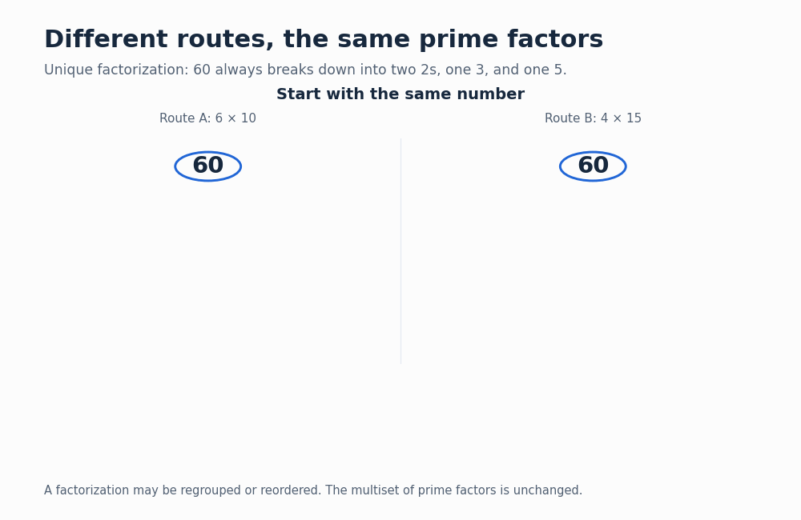

*Split 60 along two different routes. Once every factor is prime, both routes contain two 2s, one 3, and one 5. Their order changes; the prime factors do not.*

Excluding 1 from the primes keeps this statement clean. Otherwise we could keep inserting factors of 1 without changing the number. Two is the only even prime: every larger even number has 2 as an additional divisor.

There are infinitely many primes. Suppose we had a complete finite list $p_1,\ldots,p_k$. Form

$$
N=p_1p_2\cdots p_k+1.
$$

Dividing $N$ by any prime on the list leaves remainder 1. Therefore $N$ has a prime divisor missing from the list. The number $N$ itself need not be prime; the contradiction only requires a new prime factor.

This is already a useful example of proof. We did not check a very long list and decide the pattern would probably continue. We gave an argument that defeats every proposed finite list.

### A first prime test

To test an integer $n$, we can try dividing it by smaller integers. We only need to reach $\sqrt n$. If $n=ab$ and both $a$ and $b$ were greater than $\sqrt n$, their product would exceed $n$.

~~~python
from math import isqrt

def is_prime(n):
    if n < 2:
        return False
    for divisor in range(2, isqrt(n) + 1):
        if n % divisor == 0:
            return False
    return True

print([n for n in range(2, 30) if is_prime(n)])
# [2, 3, 5, 7, 11, 13, 17, 19, 23, 29]
~~~

Every line has a mathematical reason. The first condition handles numbers outside the definition. The loop implements the square-root argument. Finding one divisor is enough to reject a candidate.

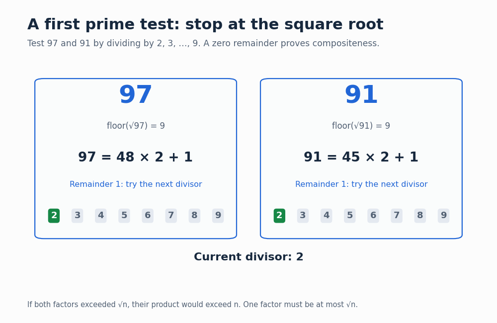

*Each attempted divisor produces an exact quotient and remainder. A zero remainder settles 91 at 7 × 13. For 97, checking through 9 is enough because its square root is less than 10.*

Running the test for each integer from 0 through 100 gives a list of primes. We can then keep a running count, written $\pi(x)$: the number of primes less than or equal to $x$.

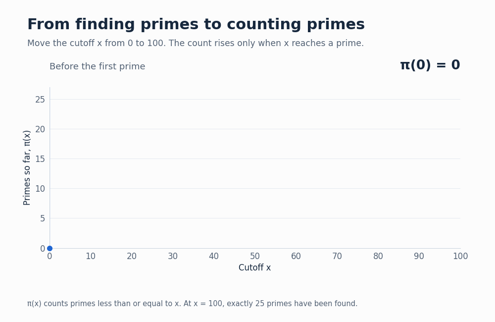

*Move the cutoff from 0 to 100. The vertical axis is the number of primes found so far, π(x). The total rises at each prime and stays flat between primes, ending at π(100) = 25. For a stationary view, open the [complete staircase](riemann/assets/prime_count_0_to_100.png).*

## 2. How we find primes today

“Find primes” hides several different tasks:

| Task | Question | Example |
|---|---|---|
| Test | Is this particular integer prime? | Is 97 prime? |
| Generate | Produce a prime satisfying some requirements. | Find a random prime with a specified bit length. |
| Enumerate or count | Which primes, or how many primes, lie below a cutoff? | List the primes up to 100. |
| Factor | Which primes multiply to a given composite number? | Recover 7 and 13 from 91. |

These tasks are related, but a fast solution to one does not automatically solve the others.

### Many small primes: the sieve

If we want every prime up to a moderate limit, we can cross out composites together. Start with the integers from 2 to the limit. Keep 2 and cross out its larger multiples. Keep the next remaining number, 3, and cross out its multiples. Continue.


*Follow the animation one number at a time: 1 is circled in gray because it is not prime. Then 2 is circled in green and 4, 6, 8, … are crossed out; 3 follows with 6, 9, 12, …, including numbers already crossed out. Each later prime gets the same treatment. This demonstration deliberately starts at $2p$ on every pass so the repeated multiples remain visible. At the end, the 25 primes are circled and the 74 composite numbers are crossed out.*

This is the sieve of Eratosthenes. When processing a prime $p$, we can begin at $p^2$: smaller multiples already have a smaller prime factor and have been crossed out.

~~~python
from math import isqrt

def primes_up_to(limit):
    if limit < 2:
        return []
    keep = [True] * (limit + 1)
    keep[0] = keep[1] = False
    for p in range(2, isqrt(limit) + 1):
        if keep[p]:
            for multiple in range(p * p, limit + 1, p):
                keep[multiple] = False
    return [n for n, prime in enumerate(keep) if prime]

print(len(primes_up_to(100)))  # 25
~~~

The exact black staircase in our later graphs comes from a separate implementation of this idea.

### One very large prime: generate candidates and test

A cryptographic library does not normally list every smaller prime before producing a large one. It generates a candidate of the required size, rejects easy failures, and performs stronger primality tests. If the candidate fails, it tries again.

OpenSSL documents small-prime trial division followed by Miller–Rabin testing. Miller–Rabin exploits modular arithmetic to expose composites without trial-dividing by every possible factor. With appropriately chosen random tests, a composite's chance of passing can be made extremely small. A passing candidate is called a *probable prime*.[^openssl]

There are also methods that establish primality conclusively. NIST's Digital Signature Standard distinguishes probable-prime and provable-prime generation. The AKS result establishes that primality can be decided deterministically in polynomial time, without assuming RH. Here the input size is the number of bits needed to write the integer. That theoretical guarantee is separate from which method is fastest in a particular implementation.[^nist][^aks]

Thus a prime can be easy to recognize without making the factorization of a large composite easy.

## 3. Where primes do useful work

### RSA: a public product with secret factors

In the familiar two-prime form of RSA, choose distinct large secret primes $p$ and $q$ and publish their product

$$
N=pq
$$

as part of a public key. The private-key construction uses information available from the factors. One such quantity is Euler's totient $\varphi(N)$, the number of integers from 1 through $N$ that share no prime factor with $N$:

$$
\varphi(N)=(p-1)(q-1).
$$

As a tiny illustration, $61\times53=3233$, and $\varphi(3233)=60\times52=3120$. Real keys use much larger numbers and a complete cryptographic scheme.

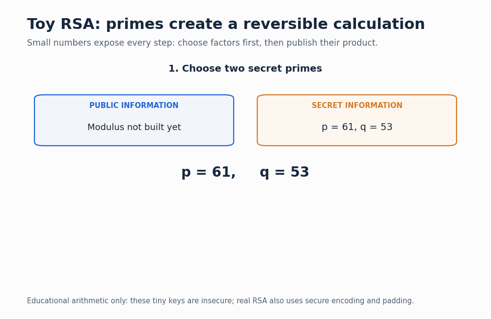

*These deliberately tiny RSA values make every stage visible: choose the factors, construct the keys, encrypt 65 into 2790, and recover 65. The example shows the arithmetic; real schemes also require secure key sizes and encoding.*

Multiplying known factors is straightforward. Recovering the factors from a large product is a different problem. Knowing $p$ and $q$ allows recovery of the RSA private key. The original RSA paper explicitly connects its security, in part, to the difficulty of factoring.[^rsa]

This is why efficient prime generation is compatible with RSA: the legitimate user chooses the factors first. An attacker is given their product. Factoring the modulus is sufficient to break RSA. Whether every efficient way to reverse RSA's public operation would also give an efficient factoring method is a separate question.[^rsa-problem]

### A prime can also define the arithmetic

Working *modulo* $p$ means keeping remainders after division by $p$. Modulo 7, for example,

$$
5+4\equiv2,\qquad 3\cdot5\equiv1.
$$

The second equation says that 5 behaves as the multiplicative inverse of 3. When the modulus is prime, every nonzero remainder has an inverse. The result is a finite field: an arithmetic system in which addition, subtraction, multiplication, and division by nonzero elements behave consistently.

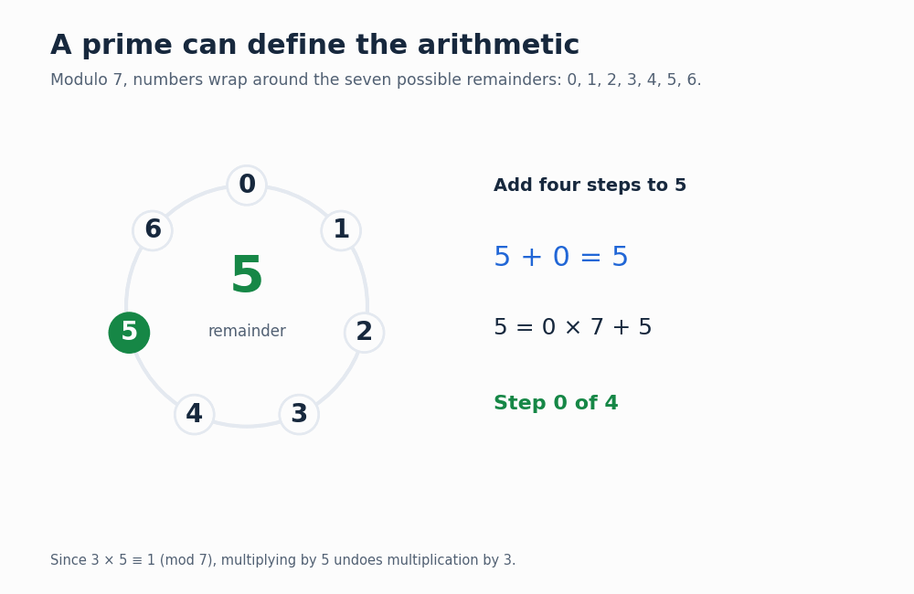

*Arithmetic modulo 7 wraps around seven remainders. Four steps from 5 end at 2; three groups of five end at 1. The second calculation makes 5 the multiplicative inverse of 3.*

X25519, an elliptic-curve method for agreeing on a shared secret, uses the public prime $2^{255}-19$. Its secret values participate in curve operations; the prime itself is published in the specification. This is a different use of primes from hiding RSA's factors.[^x25519]

### Data lookup and recovering damaged messages

Some universal hash families use arithmetic modulo a prime to spread integer keys among hash-table buckets. Choosing a function randomly from a suitable family gives a bound on collisions between different keys. The prime helps establish the guarantee; it does not mean every hash table needs a prime number of buckets.[^hashing]

Finite-field algebra also supports error-correcting codes. NASA's Galileo mission used Reed–Solomon codes over a field with $256=2^8$ elements to help recover transmitted data. The underlying prime is 2. A field of 256 elements uses a construction based on polynomials over the two-element field; it is not ordinary integer arithmetic modulo 256.[^galileo]

These examples connect prime-based mathematics to private communication, efficient computation, and reliable transmission. They use algebraic properties of particular primes or finite fields. To understand Riemann's question, we now turn to the distribution of *all* primes.

## 4. Turning a list into a staircase

Define

```math
\pi(x)=\mathrm{card}\left\lbrace p\le x : p\text{ is prime}\right\rbrace.
```

Here $\mathrm{card}$ means the number of elements in the set. The symbol $\pi(x)$ means “prime count,” not the circle constant. For example, $\pi(10)=4$ because the primes up to 10 are 2, 3, 5, and 7. Also, $\pi(100)=25$.

Plotting $\pi(x)$ gives a staircase. It jumps by one at every prime and stays flat between primes. The individual steps are irregular, but the broad trend is remarkably regular.

The prime number theorem says

$$
\pi(x)\sim\frac{x}{\log x}.
$$

The symbol $\sim$ means that the ratio tends to 1 as $x$ grows. Throughout this essay, $\log$ is the natural logarithm. A more accurate smooth guide at large scales is the logarithmic integral, defined here using the standard principal-value convention:

$$
\mathrm{li}(x)=\mathrm{PV}\int_0^x\frac{dt}{\log t}
=\mathrm{Ei}(\log x).
$$

The principal value, written PV, balances the two sides of the singularity at $t=1$. The name $\mathrm{Ei}$ denotes the exponential integral used by our numerical library. The derivative of $\mathrm{li}(x)$ is $1/\log x$, so the integral accumulates a predicted density. This motivates the heuristic that primes near a large number $x$ have average density about $1/\log x$. It does not treat primality as a sequence of independent coin flips.[^pnt][^li]

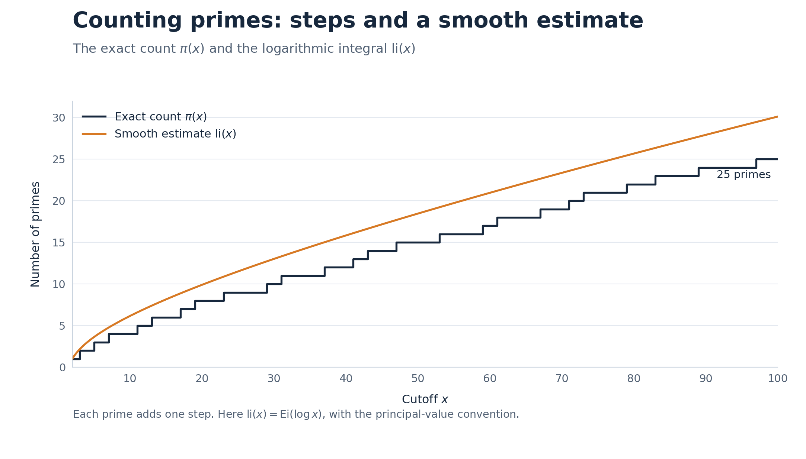

*The horizontal axis is the numerical cutoff $x$. The vertical axis counts primes up to that cutoff. The smooth curve describes an average trend; it does not reproduce each step.*

The next question is more demanding than identifying that trend: **how large can the discrepancy between the staircase and its smooth approximation become?**

## 5. A sum over integers becomes a product over primes

Begin with a function that seems to involve all positive integers equally:

$$
\zeta(s)=\sum_{n=1}^{\infty}\frac{1}{n^s}.
$$

This series converges when the real part of $s$ is greater than 1. For a concrete real input,

$$
\zeta(2)=1+\frac{1}{2^2}+\frac{1}{3^2}+\frac{1}{4^2}+\cdots.
$$

Now take one prime, say 2. The geometric-series identity gives

$$
\frac{1}{1-2^{-s}}=1+2^{-s}+2^{-2s}+2^{-3s}+\cdots.
$$

Do the same for 3, 5, 7, and every other prime, and multiply the expressions. Selecting one term from each factor amounts to selecting a power of each prime. For instance, selecting $2^{-2s}$, $3^{-s}$, and $5^{-s}$ produces

$$
(2^2\cdot3\cdot5)^{-s}=60^{-s}.
$$

Unique factorization tells us exactly why every positive integer appears once. With the convergence condition $\mathrm{Re}(s)>1$ in place, this gives Euler's product:

$$
\boxed{\displaystyle
\zeta(s)=\prod_{p\ \mathrm{prime}}\frac{1}{1-p^{-s}}.
}
$$

The same function can be assembled from all integers or from just the primes. This identity is the bridge we need.[^zeta]

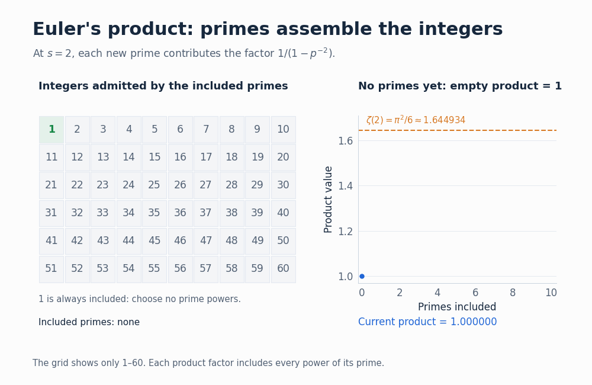

*Each added prime unlocks integers whose prime factors are now available. The grid displays integers up to 60, while each Euler factor includes every power of its prime. The numerical product approaches ζ(2) = π²/6 as more primes are included.*

There is another useful detail hidden in the product. For real $s>1$, expanding its logarithm gives

$$
\log\zeta(s)=
\sum_p\sum_{k=1}^{\infty}\frac{p^{-ks}}{k},
\qquad s>1.
$$

Primes appear together with their squares, cubes, and higher powers, weighted by $1/k$. Those weights will return when we reconstruct the prime count.

## 6. Why complex numbers enter

Write a complex input as

$$
s=\sigma+it,\qquad i^2=-1.
$$

The real number $\sigma$ is its horizontal coordinate in the complex plane, and $t$ is its vertical coordinate. For a positive integer $n$,

$$
n^{-s}=e^{-s\log n}
=n^{-\sigma}\bigl(\cos(t\log n)-i\sin(t\log n)\bigr).
$$

The size of this term is $n^{-\sigma}$, while its direction rotates as $t$ changes. Complex inputs allow cancellation among terms pointing in different directions.

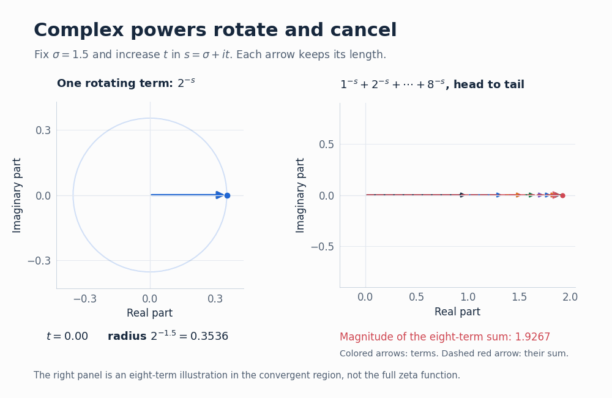

*Changing the imaginary coordinate turns the terms at different rates. Head-to-tail addition shows how their directions can partly cancel. This is a finite illustration with eight terms and real part 1.5; it is not the continued zeta function in the critical strip.*

But the original series only converges for $\sigma>1$. We cannot simply substitute $\sigma=1/2$ into that series and assume it still defines the function.

The extension is called *analytic continuation*. A familiar analogy is

$$
1+z+z^2+\cdots=\frac{1}{1-z},\qquad |z|<1.
$$

The series fails at $z=2$, but the function on the right still makes sense there. Evaluating the continued function at 2 does not make the divergent series an ordinary convergent sum.

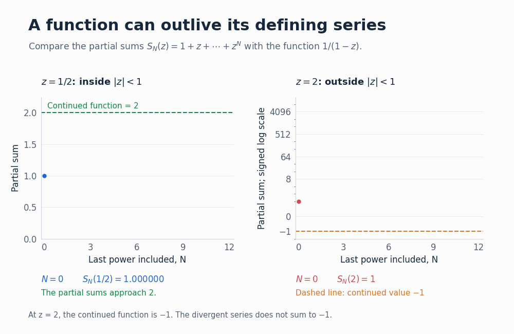

*At z = 1/2, adding terms approaches 2. At z = 2, the partial sums grow, even though the rational function 1/(1 − z) has the finite value −1. Continuing the function does not make the divergent series converge.*

For zeta, we can see part of the continuation concretely through the alternating series

$$
\eta(s)=1-\frac{1}{2^s}+\frac{1}{3^s}-\frac{1}{4^s}+\cdots.
$$

Where the original series converges, separating the even terms gives

$$
\eta(s)=(1-2^{1-s})\zeta(s).
$$

The alternating series converges in the larger region $\mathrm{Re}(s)>0$. Consequently,

$$
\zeta(s)=\frac{\eta(s)}{1-2^{1-s}}
$$

provides a continuation throughout the strip $0<\mathrm{Re}(s)<1$, where the denominator is nonzero. More generally, zeta continues across the complex plane with a single pole at $s=1$.[^zeta]

This is a crucial step in the story. The continuation lets us investigate a region that the original infinite sum could not reach.

## 7. What a zeta zero is

A zero is a complex input $\rho$ satisfying

$$
\zeta(\rho)=0.
$$

Zeta has *trivial zeros* at the negative even integers:

$$
-2,-4,-6,\ldots.
$$

Its other zeros lie in the *critical strip*

$$
0<\mathrm{Re}(\rho)<1.
$$

The Riemann hypothesis is the statement that every one of these nontrivial zeros has real part exactly $1/2$. This vertical line is called the *critical line*.[^zeros]

The first few positive imaginary parts are approximately

| Pair index | Positive height $\gamma_n$ |
|---:|---:|
| 1 | 14.134725142 |
| 2 | 21.022039639 |
| 3 | 25.010857580 |

For each listed zero $\rho_n=1/2+i\gamma_n$, its complex conjugate $1/2-i\gamma_n$ is also a zero. In our graphs, **one zero pair** means these two zeros. Ten thousand pairs therefore means 20,000 nontrivial zeros, represented by 10,000 positive heights.[^odlyzko]

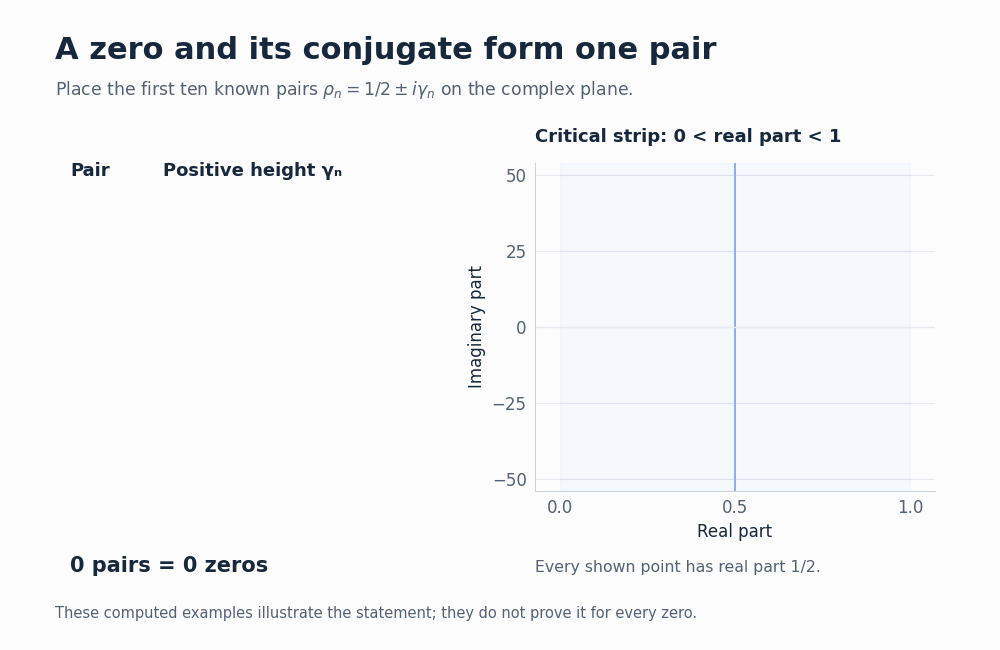

*Watch ten known conjugate pairs appear, giving 20 nontrivial zeros. Here the horizontal coordinate is the real part of a complex input; in the prime-counting graphs it is the numerical cutoff x. This finite collection illustrates the locations without proving a statement about every zero. The [still figure](riemann/assets/zeta_zeros.png) is also available.*

A symmetric arrangement by itself would not establish RH: points can be symmetric about a line while lying on either side of it. The assertion is that every nontrivial zero is actually on the line.

## 8. How a zero becomes a wave

The connection becomes easier to see by expanding a term that occurs in explicit formulas. If $\rho=\beta+i\gamma$ and $x>1$, then

$$
x^\rho=x^\beta e^{i\gamma\log x}
=x^\beta\bigl(\cos(\gamma\log x)+i\sin(\gamma\log x)\bigr).
$$

The two coordinates of a zero play different roles:

- Its real part $\beta$ controls the factor $x^\beta$.
- Its imaginary part $\gamma$ sets an oscillation frequency in $\log x$.

On the critical line, the first factor is $\sqrt{x}$. Adding a conjugate pair produces a real oscillation, which is why pairs are convenient for reconstructing a real-valued prime count.

There is a useful analogy with synthesizing a signal from frequencies. Lower zeros supply broad variations. Higher zeros supply finer variations. Near a fixed value of $x$, the phase $\gamma\log x$ changes by approximately $\gamma\Delta x/x$, so a full oscillation has local scale

$$
\Delta x\approx\frac{2\pi x}{\gamma}.
$$

This also explains a limitation: the same finite set of zeros gives coarser spatial resolution as we move farther out along the number line.

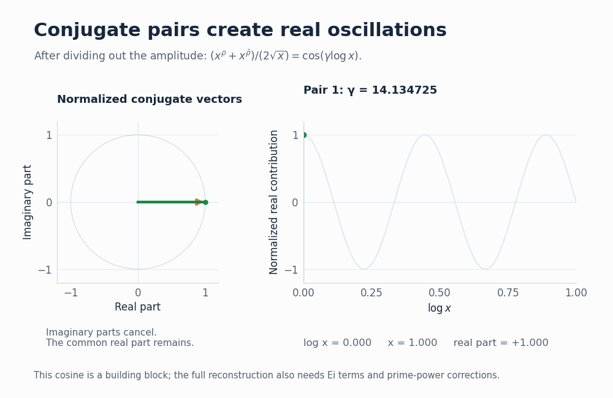

*Two conjugate rotations have opposite imaginary parts, so their sum is real. Increasing the zero height makes the oscillation faster in log(x). This animation isolates a building block; the complete prime-counting formula also needs exponential integrals and prime-power corrections.*

The analogy needs one qualification. The exact prime-counting reconstruction contains exponential-integral terms and prime-power corrections, not just a freely chosen sum of sine waves. The frequencies and weights come from the mathematics.

## 9. The explicit formula: rebuilding the staircase

The most natural intermediate function counts prime powers with the weights we saw in $\log\zeta(s)$:

$$
J(x)=\sum_{p^k\le x}\frac1k
=\pi(x)+\frac12\pi(\sqrt{x})
+\frac13\pi(x^{1/3})+\cdots.
$$

A prime contributes 1. Its square contributes another $1/2$, its cube another $1/3$, and so on.

For example, below 10 there are four primes, two prime squares (4 and 9), and one prime cube (8). Therefore

$$
J(10)=4+\frac12\cdot2+\frac13\cdot1=\frac{16}{3}.
$$

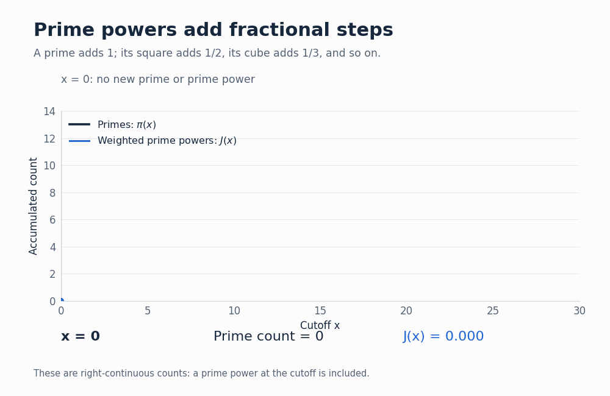

*The weighted staircase J also jumps at prime powers. A prime adds 1, its square adds 1/2, its cube adds 1/3, and so on. Compare those extra steps with the ordinary prime count. This animation uses the right-continuous counts, before applying the midpoint convention.*

Riemann's explicit formula expresses this function using the zeros. A convenient paired form is

$$
\begin{aligned}
J_0(x)={}&\mathrm{Ei}(\log x)
-2\lim_{T\to\infty}\mathrm{Re}
\sum_{0<\mathrm{Im}(\rho)\le T}
\mathrm{Ei}(\rho\log x)\\
&-\log2+
\int_x^\infty\frac{dt}{t(t^2-1)\log t}.
\end{aligned}
$$

The subscript 0 specifies a midpoint convention: at a jump, use the average of the left and right limits. Away from prime powers, $J_0(x)=J(x)$. Zeros are counted with multiplicity and ordered by increasing height, with conjugates combined before taking the limit.[^explicit]

Read the formula as three ingredients: a smooth logarithmic-integral term, oscillatory corrections supplied by nontrivial zeros, and the remaining constant and trivial-zero correction. The formula is a theorem connecting zeros and prime powers; its validity does not depend on assuming that the zeros lie on the critical line.

### Removing the prime powers

We still want ordinary primes, so we must undo the extra counting. Möbius inversion does exactly that:

$$
\pi_0(x)=\sum_{m\ge1}\frac{\mu(m)}{m}J_0(x^{1/m}).
$$

The Möbius function $\mu(m)$ is zero if a squared prime divides $m$. Otherwise it is $(-1)^r$, where $r$ is the number of distinct prime factors. In particular,

$$
\mu(1)=1,\quad
\mu(2)=\mu(3)=\mu(5)=-1,\quad
\mu(4)=0,\quad
\mu(6)=1.
$$

This is an inclusion-and-exclusion correction: subtract the square and cube contributions, then restore contributions subtracted too often. For $2\le x\le100$, only $m\le6$ can contribute in the exact formula, so

$$
\boxed{\displaystyle
\pi_0(x)=J_0(x)
-\frac12J_0(\sqrt{x})
-\frac13J_0(x^{1/3})
-\frac15J_0(x^{1/5})
+\frac16J_0(x^{1/6}).
}
$$

For example, at $x=10$ the correction gives $16/3-1-1/3=4$. For $m\ge7$, even $100^{1/m}<2$, below the first prime, so the remaining exact terms vanish.

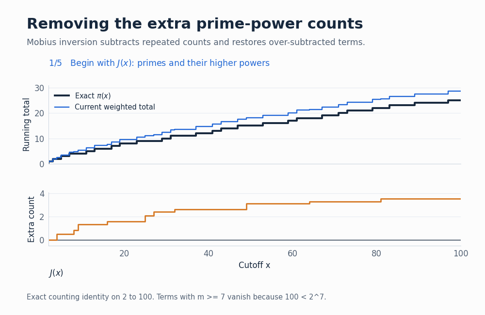

*Start with J, subtract the square, cube, and fifth-power contributions, then restore the sixth-power overlap. The final curve matches the prime staircase. These are exact right-continuous counts J and π; the midpoint versions in the displayed formula use the same correction.*

At an ordinary nonprime point, $\pi_0(x)=\pi(x)$. At a prime $p$, the midpoint convention gives

$$
\pi_0(p)=\pi(p)-\frac12.
$$

This half-step matters when we inspect the graphs closely.

## 10. Add 10, then 50, then 10,000 zero pairs

For computation, replace the infinite zero sum by its first $K$ pairs. Call the resulting weighted count $\widehat J_K(x)$, and apply the same prime-power correction to obtain $\widehat\pi_K(x)$. The hats mark finite approximations: $\widehat J_0$ means the smooth calculation with no zero pairs, whereas $J_0$ in the exact formula means the midpoint convention.

The experiment has two independent inputs:

1. A sieve supplies the exact reference staircase.
2. A table of zeta-zero heights supplies the reconstruction.

**The list of primes is never passed to the reconstruction function.** The two outputs are compared only after they have been computed.

The zero heights come from Andrew Odlyzko's published table. We use the first 10,000 positive heights, ending near $\gamma_{10000}=9877.782654004$. The source states an absolute accuracy of $3\times10^{-9}$ for the table.[^odlyzko]

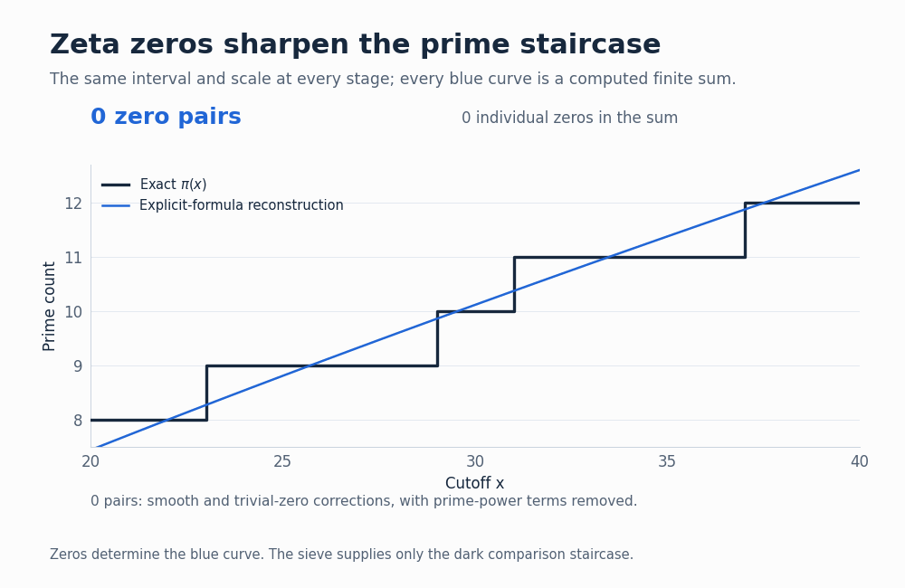

*Keep the interval and vertical scale fixed while the zero-pair count increases from 0 to 10,000. Every displayed reconstruction is computed from that many zero pairs. The black staircase comes from an independent sieve. The zero-pair-free curve includes the smooth and trivial-zero corrections; it is not simply the logarithmic integral. For side-by-side comparisons, open the [six-panel still figure](riemann/assets/zero_pair_progression.png).*

With few zeros, the broad trend is visible but individual steps are blurred. Additional zeros sharpen the transitions. By 10,000 pairs, the reconstructed curve almost lies on the staircase at this scale.

We can measure the improvement instead of relying only on the picture. The following values are errors at the 98 half-integers $2.5,3.5,\ldots,99.5$, chosen to stay away from the prime jumps:

| Zero pairs | Mean absolute error in prime count | Largest absolute error on these points |
|---:|---:|---:|
| 0 | 0.325460 | 0.976994 |
| 10 | 0.187564 | 0.615364 |
| 50 | 0.090096 | 0.359967 |
| 200 | 0.033206 | 0.134489 |
| 1,000 | 0.009428 | 0.032872 |
| 10,000 | 0.001497 | 0.006710 |

These are measurements for this interval and these sample points. They are not universal error bounds, and increasing $K$ need not improve the approximation at every individual location. The [reproduction notes](riemann/REPRODUCE.md) explain the calculation and numerical checks.

## 11. What remains visible at 10,000 pairs

Here are just the exact curve and the reconstruction using 10,000 pairs:

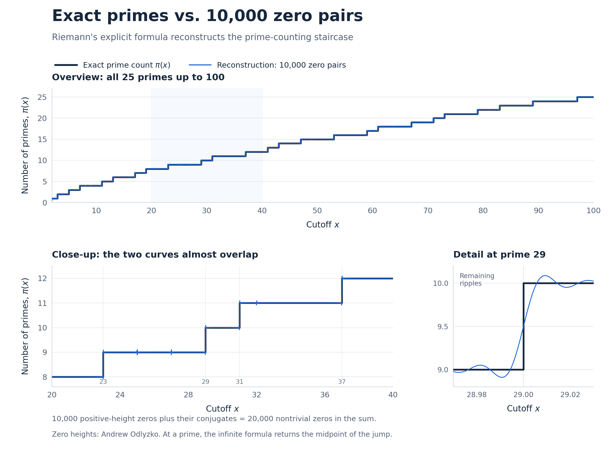

*The overview nearly hides the difference. The tight detail at 29 reveals a smooth transition and small oscillations around the jump.*

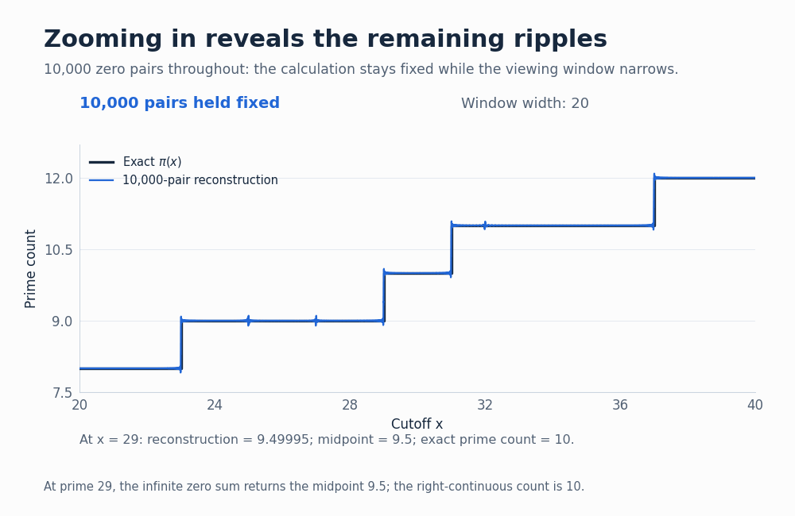

*Keep all 10,000 pairs fixed and zoom toward 29. The curves that appeared to coincide now reveal a rounded transition and ringing. The approximation passes near 9.5 at the jump, although the ordinary prime count at 29 is 10. Only the magnification changes during this animation.*

Immediately below 29 there are nine primes; at 29 and immediately above it there are ten. At $x=29$, our finite reconstruction is approximately $9.49995$, close to the midpoint value $9.5$ specified by the infinite formula.

The overshoot and undershoot near that jump are a form of Gibbs ringing. A finite collection of smooth oscillatory terms is approximating a discontinuity. Increasing the number of terms compresses the transition and the surrounding ripples. It does not turn a finite sum into a discontinuous staircase.

This is why the picture must be interpreted at a stated scale. A plot that looks exact when shown across 100 integers can reveal structure when magnified to a width of a few hundredths.

The graph also illustrates a distinction worth preserving even after a proof of RH: a finite computation shows what happens for the inputs and zero data it uses. A theorem supplies a reason that covers infinitely many cases. Our Python experiment does not inspect every zero or verify the new formal proof.

### The same 10,000 pairs near much larger primes

What happens if we keep those zero pairs and move the magnifying glass far along the number line? These four experiments center on the first prime after one million, one billion, one trillion, and 1,000 trillion. Here 1,000 trillion means one quadrillion, or $10^{15}$.

| Scale | Focal prime $p$ | Exact number of primes through $p$ |
|---|---:|---:|
| 1 million | 1,000,003 | 78,499 |
| 1 billion | 1,000,000,007 | 50,847,535 |
| 1 trillion | 1,000,000,000,039 | 37,607,912,019 |
| 1,000 trillion | 1,000,000,000,000,037 | 29,844,570,422,670 |

The exact counts start from Tomás Oliveira e Silva's published counts at the four powers of ten. Separate integer primality checks identify each local step, and the bundled data include certificates for the four focal primes. We use those counts only for the reference staircase and the error calculation; they are not inputs to the zero-based formula.[^large-counts]

Each animation uses the same window: 200 numbers below the chosen prime and 200 above it. The horizontal axis is the offset $h=x-p$, so zero marks the focal prime. The reconstruction is evaluated at 14 actual stages: **0, 1, 2, 5, 10, 20, 50, 100, 200, 500, 1,000, 2,000, 5,000, and 10,000 pairs**. The zero-pair-free stage retains the smooth, constant, trivial-zero, and prime-power corrections. The animation holds each evaluated curve; it does not invent intermediate curves by morphing between stages.

To read the two panels, write $F_K(x)=\widehat\pi_K(x)$ and let $A=\pi(p^-)+1/2$, the exact midpoint of the jump at the focal prime.

- **Upper panel: the actual count comparison.** Both curves subtract the same value $A$: the reconstruction shows $F_K(p+h)-A$, and the staircase shows $\pi(p+h)-A$. This keeps their vertical difference intact. The fixed symmetric-log axis has ordinary linear spacing near zero and compresses large positive and negative values so the full error remains visible.
- **Lower panel: shape with vertical error removed.** The reconstruction shows $F_K(p+h)-F_K(p)$. Its center has deliberately been moved to zero, allowing us to inspect its local slope and curvature. Passing through the center here is guaranteed by this alignment; it does not show that the absolute prime count is correct. The upper panel and its displayed center error retain that information.

The marked point $(0,0)$ is the exact midpoint target in both panels. The ordinary counting staircase itself jumps from $-1/2$ to $+1/2$ at the center. As before, the infinite explicit formula takes the midpoint of that jump.

#### Near one million

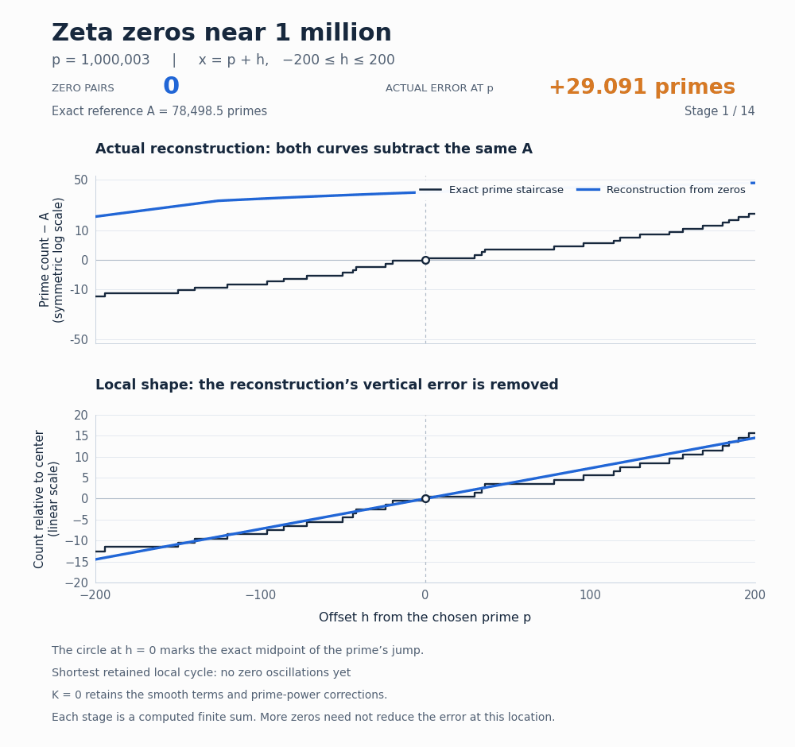

*Near 1,000,003, the added zeros produce visible curvature, but 10,000 pairs still blur the individual steps. The final midpoint error is about −0.703 primes. Open the [10,000-pair still figure](riemann/assets/large_prime_1m.png) to inspect the last stage.*

#### Near one billion

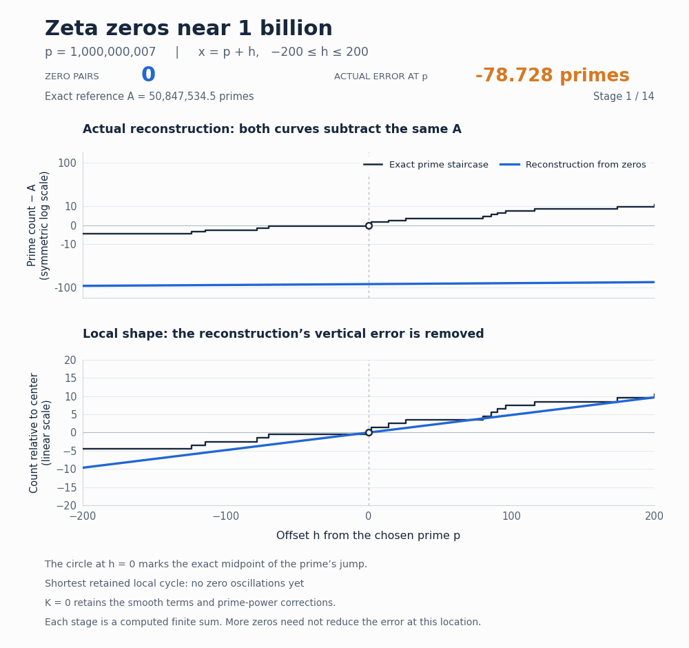

*Near 1,000,000,007, the absolute estimate moves as more zeros are added, while its local shape changes very little across these 400 numbers. At 10,000 pairs, the midpoint error is about −14.838 primes. The [still figure](riemann/assets/large_prime_1b.png) keeps the actual error and the aligned shape visible together.*

#### Near one trillion

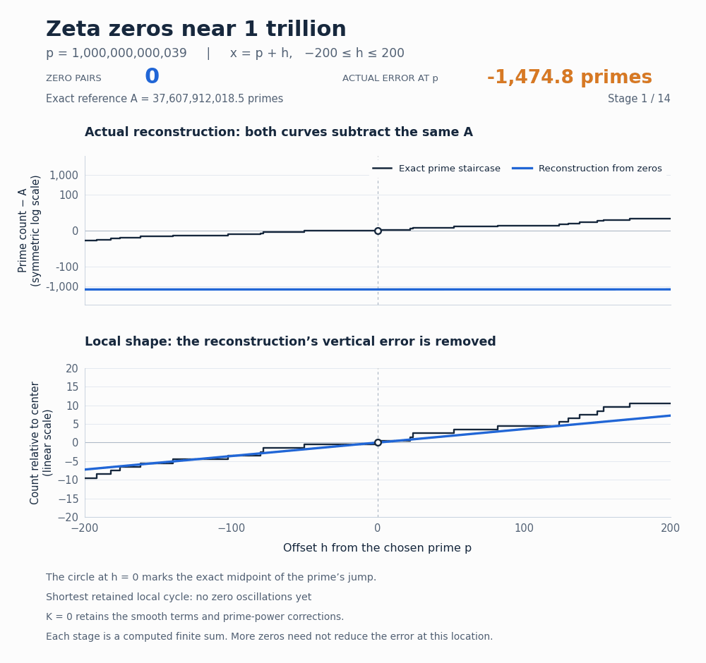

*Near 1,000,000,000,039, the final estimate is about 1,001.2 primes below the exact midpoint. A nearly straight local curve can describe the average rate of increase while missing both the accumulated count and the individual jumps. Open the [still figure](riemann/assets/large_prime_1t.png) for the final comparison.*

#### Near 1,000 trillion

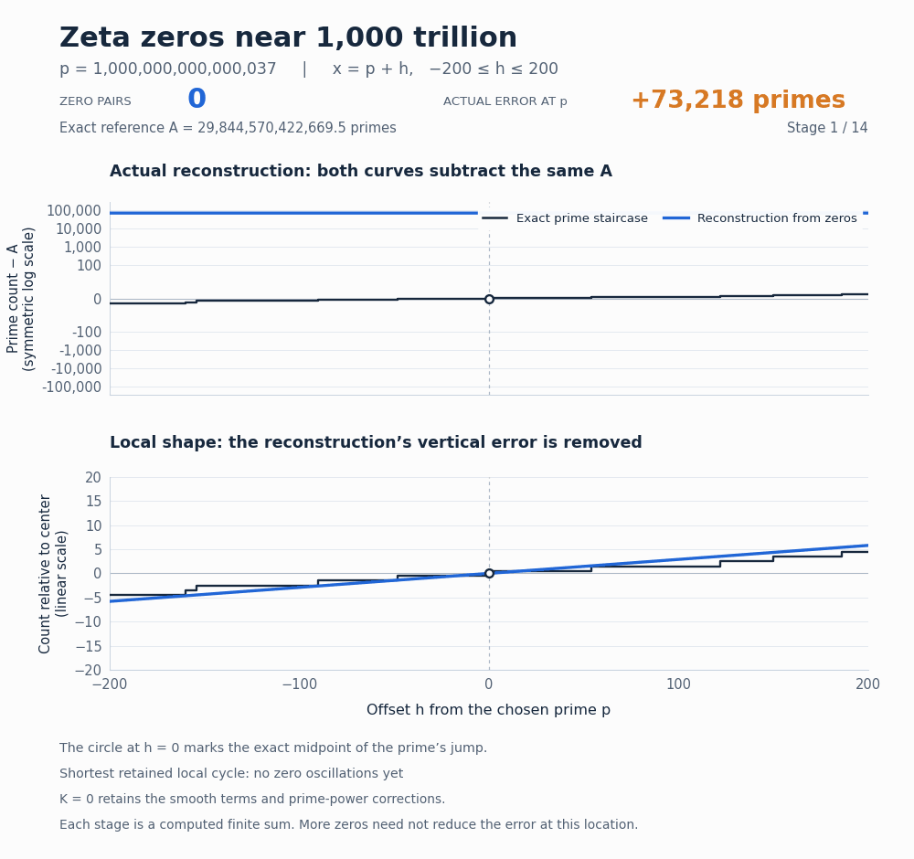

*Near 1,000,000,000,000,037, the 10,000-pair estimate is about 1,872 primes above the midpoint. The lower curve remains almost straight throughout the animation because even the highest retained zero changes phase extremely slowly over this window. The [still figure](riemann/assets/large_prime_1000t.png) preserves the final stage.*

#### Why the steps do not sharpen here

The phase calculation in Section 8 explains what we are seeing. For the highest retained zero, one local cycle spans approximately $2\pi p/\gamma_{10000}$ numbers. Evaluating that scale at these four primes gives:[^explicit-scales]

| Scale | Approximate length of the fastest retained cycle | 10,000-pair midpoint error | Bound from zero-height precision alone |
|---|---:|---:|---:|
| 1 million | 636 numbers | −0.703 primes | 0.0000264 primes |
| 1 billion | 636,093 numbers | −14.838 primes | 0.000818 primes |
| 1 trillion | 636,092,687 numbers | −1,001.2 primes | 0.0258 primes |
| 1,000 trillion | 636,092,686,716 numbers | +1,872 primes | 0.815 primes |

These cycle lengths describe the oscillatory resolution of this finite sum; they are not rigorous limits on every possible reconstruction method. Near one million, even the shortest cycle covers about 46 typical prime gaps. At the other three scales it is much wider than our entire 400-number window. Keeping the same 10,000 pairs therefore does not resolve individual primes this far out. To see smaller features at larger $x$, we need much higher zero heights.

Watch the upper panels as carefully as the lower ones: **adding more zeros need not improve the answer at this particular prime on every stage**. An intermediate estimate can land closer to the exact midpoint than a later one. Alignment in the lower panel also removes an error by construction; it does not remove that error from the mathematical estimate.

The final column is a separate precision limit. It propagates the source table's stated uncertainty of $3\times10^{-9}$ per zero height through our finite formula, using a conservative worst-case bound rounded upward.[^odlyzko] It is neither the error from omitting later zeros nor an estimate of floating-point error. The large-scale evaluator checks its numerical calculations separately and computes small local changes directly, avoiding the loss of precision that can occur when subtracting two enormous totals. Its implementation and checks are described in the [reproduction notes](riemann/REPRODUCE.md#large-prime-windows).

## 12. What RH says about the error

Return to the discrepancy

$$
E(x)=\pi(x)-\mathrm{li}(x).
$$

A standard equivalent formulation of RH is

$$
\pi(x)=\mathrm{li}(x)+O(\sqrt{x}\log x).
$$

The $O$ notation says that, beyond some cutoff, the absolute error is bounded by a constant times $\sqrt{x}\log x$. It is a bound on the accumulated prime count, not an exact prediction of the next prime.[^bombieri]

The explicit formula explains why the real part $1/2$ is significant. A zero with real part $\beta$ contributes terms involving $x^\beta$. Locating the nontrivial zeros on the critical line constrains the scale of the fluctuations. Turning this observation into the stated error estimate requires control of the whole zero sum, not merely bounding one oscillation.

There is also a precise classical bound: RH is equivalent to

$$
\left|\pi(x)-\mathrm{li}(x)\right|
<\frac{\sqrt{x}\log x}{8\pi},
\qquad x\ge2657.
$$

Here the $\pi$ in $8\pi$ is the circle constant.[^pnt]

An illustrative calculation makes the scale concrete. At $x=10^{12}$, the right-hand side is about $1.10$ million. The smooth estimate $\mathrm{li}(10^{12})$ is about $3.76\times10^{10}$, so this bound is small relative to the estimated total count. It is still an allowed error of more than a million: a rigorous estimate and an exact answer serve different purposes.

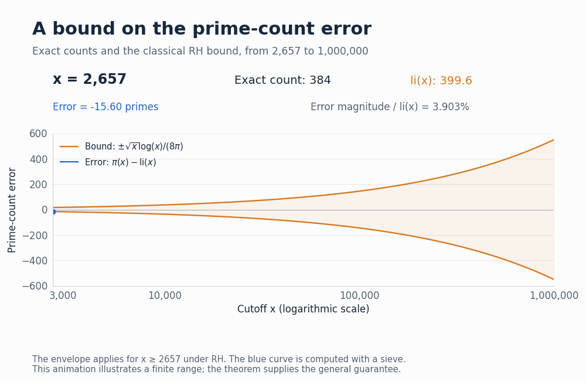

*Move through cutoffs from 2,657 to one million. The blue discrepancy is computed from exact sieve counts; the orange envelope is the classical bound stated above. The numerical example covers a finite range, while the theorem supplies the general guarantee.*

The same global statement cannot be established by our very accurate small graph. The graph helps us see the mechanism; the theorem controls it beyond the plotted range.

## 13. How does this help us as humans?

The immediate mathematical value is a stronger guarantee about prime distribution. A proof turns results established under RH into unconditional theorems, provided RH was the assumption they actually required. That is useful in reasoning about prime counts, error terms, and the intervals in which primes must occur.

One concrete historical example is the computation of $\pi(10^{24})$. An early analytic computation used RH, and David Platt later verified that count unconditionally. This is the kind of practical distinction that an assumption makes: not necessarily a different numerical answer, but a different justification for trusting it.[^primecount][^platt]

For an existing algorithm, removing an unproved assumption may strengthen its guarantee without changing a single instruction or making it run faster. New speedups would require additional algorithmic ideas. A useful proof might supply those ideas, but that is work to identify and demonstrate.

The distinction between RH and its generalizations also matters. Ordinary RH concerns the single function $\zeta(s)$. Dirichlet $L$-functions describe finer questions such as the distribution of primes among arithmetic progressions. Other families of zeta and $L$-functions lead to further generalizations.

The November 2026 verification record explicitly covers RH and GRH for Dirichlet $L$-functions. It does not claim every extension to general Dedekind zeta, Hecke, or automorphic $L$-functions. When applying the result to an older conditional theorem, we must match its assumption to the family actually covered.[^verification]

For everyday technology, the consequences should be stated carefully. RSA, elliptic-curve key agreement, hash tables, and error-correcting codes already had functioning constructions and proofs of their relevant algebraic properties. A prime-distribution theorem does not by itself supply an efficient method to factor a specific RSA modulus. Nor does it automatically accelerate every program that uses primes.

There is a wider human value in making previously separate ideas explain one another. We began with whole-number division and reached a relationship between a discrete staircase and complex oscillations. Learning to move between such descriptions can suggest methods beyond the question that first motivated them.

The recent proof also sharpens the Feynman theme. Establishing that an argument is logically valid and understanding its organizing ideas are related achievements with different demands. Alpöge's announcement explicitly describes the work of understanding, simplifying, and communicating the argument that remains after the formalization.[^announcement]

For this essay, the goal is smaller and concrete: rebuild enough of the connection that the sentence “the zeros encode the primes” has an operational meaning. We can supply zero heights to a program, add the corresponding contributions, remove the prime-power terms, and watch the prime-counting steps appear.

That leaves us with a useful habit: when a remarkable result appears, ask what we can construct from it, what we can verify, and what we can explain.

## 14. Reproduce the experiment

The figures, zero data, and Python implementation are included in the [riemann directory](riemann/REPRODUCE.md).

From the repository root, with Python and a suitable environment:

~~~bash
python -m pip install -r riemann/requirements.txt
python riemann/generate_figures.py
python riemann/generate_animations.py
~~~

These commands rebuild all 20 GIFs and nine PNGs. The original figure generator produces five PNGs; the animation generator also saves the four large-prime final snapshots. The code keeps the exact reference counts separate from the zero-based reconstruction and records numerical validation. It includes a direct implementation of the finite formula, an accelerated evaluation for the small-number plots, and a separate evaluator for stable local calculations near the four large primes.

Three implementation choices deserve explanation:

1. **Evaluate the complex exponential integral directly.** The code uses $\mathrm{Ei}(\rho\log x)$. Computing a complex power first and then taking its principal logarithm can wrap the phase and evaluate the wrong expression.
2. **Use a fixed prime-power cutoff within each plotted window.** For $2\le x\le100$, the Möbius sum uses $m\le6$ everywhere. The four large-prime windows use cutoffs 19, 29, 39, and 49 respectively. The exact $J(y)$ vanishes below 2, but its finite approximation need not. Changing the cutoff as $x$ moves can therefore introduce artificial jumps.
3. **Distinguish numerical error, source precision, and truncation error.** Agreement between two implementations of the same finite formula checks the numerical evaluation. The zero table's finite precision contributes a separate uncertainty. After accounting for those effects, comparison with the prime staircase reveals the error from retaining finitely many zeros. None of these finite checks is a proof about every zero.

Useful next experiments are to compare behavior at primes and prime powers, test how smoothing the zero cutoff changes the ringing, or increase the zero heights available to the large-prime experiment. The four large-scale windows now have their own evaluator and numerical checks; extending to a new scale or a wider window requires checking that numerical regime too. Each experiment asks a precise question that the code can help answer.

## Sources and further reading

[^feynman]: Caltech Magazine, [“Biology through the Eyes of a Physicist”](https://magazine.caltech.edu/post/biology-through-the-eyes-of-a-physicist), July 2021. Records the quotation found on Feynman's blackboard.
[^lean]: Lean FRO and Mathlib Initiative, [“Lean verification of the Riemann Hypothesis”](https://leanprover-community.github.io/blog/posts/riemann-hypothesis/), November 21, 2026.
[^verification]: Andrew Sutherland, MIT, [“Verification files for the Lean proof of the Riemann Hypothesis”](https://math.mit.edu/~drew/grh/), record consulted November 24, 2026. Includes the precise scope of the five verified statements.
[^announcement]: Levent Alpöge, [announcement of the formal proof](https://alpo.ge/remark.pdf), November 20, 2026. The [community repository](https://github.com/leanprover-community/riemann-hypothesis) maintains the formalization.
[^openssl]: OpenSSL 3.5 documentation, [BN_generate_prime](https://docs.openssl.org/3.5/man3/BN_generate_prime/).
[^nist]: NIST, [FIPS 186-5: Digital Signature Standard](https://nvlpubs.nist.gov/nistpubs/FIPS/NIST.FIPS.186-5.pdf), especially the prime-generation and primality-testing appendices.
[^aks]: Manindra Agrawal, Neeraj Kayal, and Nitin Saxena, [“PRIMES is in P”](https://annals.math.princeton.edu/2004/160-2/p12), *Annals of Mathematics* 160 (2004), 781–793.
[^rsa]: Ronald Rivest, Adi Shamir, and Leonard Adleman, [“A Method for Obtaining Digital Signatures and Public-Key Cryptosystems”](https://people.csail.mit.edu/rivest/Rsapaper.pdf), 1978.
[^rsa-problem]: Ronald Rivest and Burt Kaliski, [“RSA Problem”](https://people.csail.mit.edu/rivest/pubs/RK03.prepub.pdf), 2003.
[^x25519]: A. Langley, M. Hamburg, and S. Turner, [RFC 7748: Elliptic Curves for Security](https://www.rfc-editor.org/rfc/rfc7748.html), 2016, especially Sections 4.1 and 6.1.
[^hashing]: MIT 6.006, [Recitation 4: Hashing](https://ocw.mit.edu/courses/6-006-introduction-to-algorithms-spring-2020/bd220fb629aefdf30f416b5abf45d38d_MIT6_006S20_r04.pdf), Spring 2020.
[^galileo]: K.-M. Cheung, M. Belongie, and K. Tong, [“End-to-End System Consideration of the Galileo Image Compression System”](https://ipnpr.jpl.nasa.gov/progress_report/42-126/126E.pdf), JPL TDA Progress Report 42-126, 1996.
[^pnt]: NIST Digital Library of Mathematical Functions, [Section 27.12: Asymptotic Formulas—Primes](https://dlmf.nist.gov/27.12), especially Equation 27.12.7 for the explicit RH-equivalent error bound.
[^li]: NIST Digital Library of Mathematical Functions, [Section 6.2: Exponential and Logarithmic Integrals](https://dlmf.nist.gov/6.2), especially Equation 6.2.8.
[^zeta]: NIST Digital Library of Mathematical Functions, [Section 25.2: Definition and Expansions](https://dlmf.nist.gov/25.2), for the Dirichlet series, continuation, alternating representation, and Euler product.
[^zeros]: NIST Digital Library of Mathematical Functions, [Section 25.10: Zeros](https://dlmf.nist.gov/25.10).
[^odlyzko]: Andrew Odlyzko, [Tables of zeros of the Riemann zeta function](https://www-users.cse.umn.edu/~odlyzko/zeta_tables/), specifically the [first 100,000 zero heights](https://www-users.cse.umn.edu/~odlyzko/zeta_tables/zeros1), of which this experiment uses the first 10,000.
[^explicit]: Bernhard Riemann, [“On the Number of Prime Numbers less than a Given Quantity”](https://www.maths.tcd.ie/pub/HistMath/People/Riemann/Zeta/EZeta.pdf), 1859, English translation by David R. Wilkins. For a modern statement of the formula with the constant, integral correction, and Möbius inversion, see [“Riemann's explicit formula, one zero at a time”](https://math.ucr.edu/home/baez/mathematical/riemann_explicit_formula/riemann_explicit_formula.html), hosted by John Baez at UC Riverside.
[^explicit-scales]: John Baez, [“Riemann's Explicit Formulas”](https://math.ucr.edu/home/baez/mathematical/riemann_explicit_formula/explicit_formulas.html), October 31, 2026. Explains the oscillation phase, the local cycle scale, the Möbius corrections, and the midpoint convention. The large-scale cycle lengths and finite-sum errors here are computed from the bundled zero table by this repository's code.
[^large-counts]: Tomás Oliveira e Silva, [Tables of values of pi(x) and of pi2(x)](https://sweet.ua.pt/tos/primes.html), specifically the [first 23 values of pi(10^k)](https://sweet.ua.pt/tos/primes/1d00.txt.gz), updated March 28, 2007. The four source counts, local prime lists, primality certificates, and verification metadata are recorded in [large_prime_windows.json](riemann/data/large_prime_windows.json). The source counts are used as published; the reproduction code checks the local integers and certificates without recomputing those four full prime counts.
[^bombieri]: Enrico Bombieri, “The Riemann Hypothesis,” in the Clay Mathematics Institute's [*The Millennium Prize Problems*](https://www.claymath.org/wp-content/uploads/2022/02/MPPc.pdf), for the equivalent prime-counting error formulation and mathematical context.
[^primecount]: Jan Büthe, [Analytic computation of the prime-counting function](https://www.math.uni-bonn.de/people/jbuethe/topics/AnalyticPiX.html).
[^platt]: David J. Platt, [“Computing $\pi(x)$ Analytically”](https://arxiv.org/abs/1203.5712), describing the unconditional verification of $\pi(10^{24})$.
